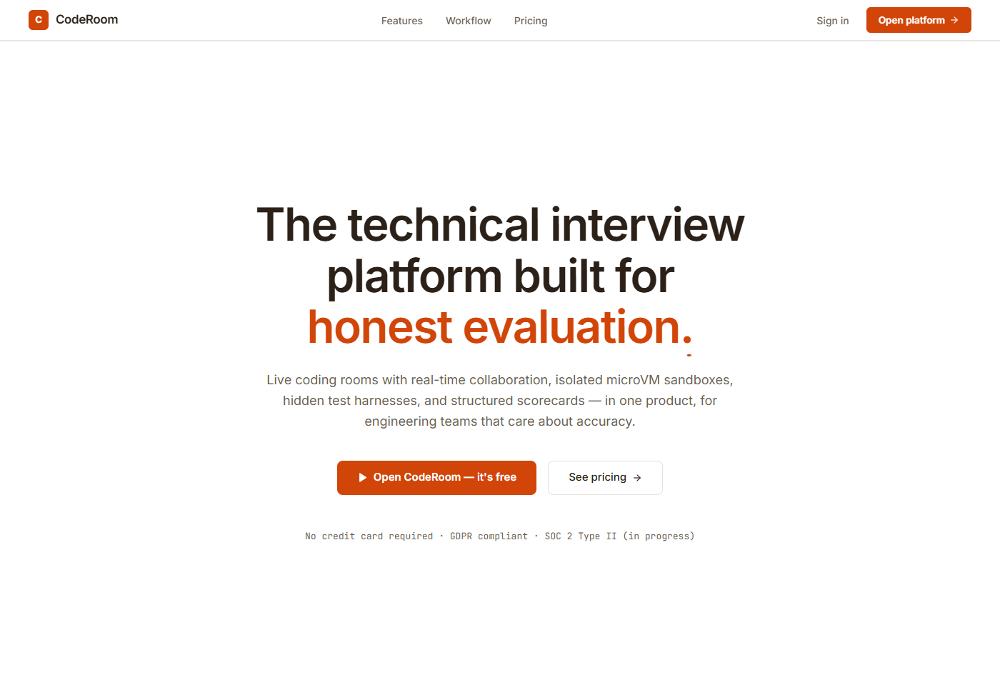

# CodeRoom — Live Technical Interview Platform

> **The technical interview platform built for honest evaluation.**  
> Conduct real-time collaborative coding interviews in isolated microVM sandboxes with zero candidate setup, hidden test harnesses, and bias-free scorecards.

---

## 📸 Platform Preview

<p align="center">
  
</p>

---

## 💡 What is CodeRoom? (Explained Simply)

If you have never used or built an interview platform before, here is what **CodeRoom** does:

When tech companies interview software engineers, asking candidates to write code in Google Docs or screen-share their messy local computer is slow, frustrating, and prone to cheating. 

**CodeRoom replaces that entire hassle with a single browser tab:**
1. **The Interviewer** creates an interview room with custom coding problems in Python, TypeScript, Go, Java, or C++.
2. **The Candidate** clicks a private link sent via email or Slack. They **do not need to create an account, enter a password, or download any software**.
3. **Both people code together live** in a shared Monaco editor (the same engine that powers VS Code) with synchronized typing, video/audio tiles, and terminal output.
4. **Code runs safely in an isolated sandbox** and gets tested against secret, hidden test cases to accurately evaluate the candidate's engineering skills.
5. **The Interviewer submits a structured scorecard** based on standardized rubrics to make fair hiring decisions.

---

## ⚡ Key Features

| Feature | Description |
| :--- | :--- |
| **🛡️ Isolated Cloud Sandboxes** | Untrusted candidate code runs in sandboxed environments with strict memory and CPU caps. |
| **💻 Multi-Language Monaco Editor** | Full VS Code editing experience with syntax highlighting for Python, TypeScript, Java, C++, and Go. |
| **⚡ Real-Time WebSockets** | Bi-directional code synchronization, editor locks, execution broadcasts, and chat. |
| **🔒 Hidden Test Harnesses** | Author secret test cases that validate candidate code without leaking the test inputs or expected answers. |
| **📊 Integrity Telemetry** | Non-invasive signals for copy-paste bursts and tab switching without creepy biometric surveillance. |
| **📋 Standardized Scorecards** | Multi-axis evaluation rubrics (Problem Solving, Code Quality, Communication, System Design) for bias-free hiring. |

---

## 🔄 How Inviting & Joining Works

```
[ 01 Schedule Room ] ──► [ 02 Share Private Link ] ──► [ 03 Candidate Enters ] ──► [ 04 30s Check & Code ]
```

1. **`01` Schedule the Room:** Enter candidate name, target role, question set, and language preference. An isolated sandbox is prepared in seconds.
2. **`02` Share Private Invite:** Copy the single-use cryptographic token link or dispatch an automated email invite. No candidate account or password is ever required.
3. **`03` Candidate Clicks & Joins:** Candidate opens the link in any modern browser (Chrome, Edge, Firefox, Safari) with zero software download.
4. **`04` Code, Run & Collaborate:** An automated 30-second diagnostics check verifies audio/video and latency (<30ms). Both enter the synchronized workspace.

---

## 🛠️ Tech Stack

### Frontend (`/frontend`)
* **React 19** + **TypeScript**
* **Vite** (Next-generation bundler)
* **Tailwind CSS** (Clean typography & styling)
* **@monaco-editor/react** (VS Code browser editor)
* **Lucide React** (Icons)
* **@lucasmarkes/hairline** (Interactive 3D isometric wireframe illustrations)
* **MagicUI Marquee** (Dual opposing testimonial scroller)

### Backend (`/backend`)
* **Node.js** + **Express** (REST API)
* **WebSocket (`ws`)** (Real-time live code synchronization & chat relay)
* **In-memory & Sandboxed Execution Engine** (Pre-configured for PostgreSQL/Redis and Docker microVM runners)

---

## 🚀 Quick Start (Running Locally)

Follow these steps to run the platform on your computer:

### 1. Prerequisites
Make sure you have **Node.js** installed (version 18 or newer).  
Check by running:
```bash
node -v
npm -v
```

### 2. Clone the Repository
```bash
git clone https://github.com/your-username/coderoom.git
cd coderoom
```

### 3. Install All Dependencies
Install the root, frontend, and backend packages with one command:
```bash
npm run install:all
```

### 4. Start Both Servers (Frontend + Backend)
Run both the API server and UI simultaneously:
```bash
npm run dev
```

* **Frontend UI:** Open [http://localhost:5173](http://localhost:5173) in your browser.
* **Backend API:** Running on [http://localhost:3001](http://localhost:3001).
* **WebSocket Server:** Connected on `ws://localhost:3001`.

---

## 📁 Project Structure

```text
coderoom/
├── backend/
│   ├── src/
│   │   ├── data/           # Mock interview, questions, and scorecard data
│   │   ├── routes/         # REST API routes (interviews, questions, execute, admin)
│   │   ├── services/       # Database store and sandbox execution engine
│   │   └── server.ts       # Express server and WebSocket connection handler
│   └── package.json
│
├── frontend/
│   ├── src/
│   │   ├── components/     # UI widgets, Monaco editor, sidebar, modals, video tiles
│   │   ├── pages/          # Home, Pricing, Sign-in, Candidate Join, Dashboard
│   │   ├── App.tsx         # App routing and shell
│   │   └── main.tsx        # React root entry point
│   └── package.json
│
├── docs/
│   └── images/
│       └── platform-overview.png   # Platform screenshot preview
│
├── .env.example            # Environment variables template
├── .gitignore              # Protected sensitive files & keys
└── package.json            # Root workspaces orchestrator
```

---

## 📄 License & Credits

Built with modern web standards and open-source software for engineering teams everywhere.
